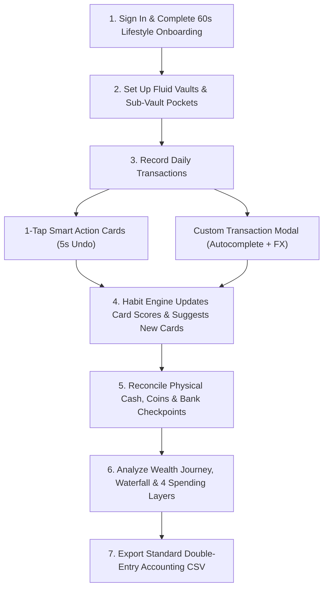

# Vault Tracking — Personal Finance, Smart Action Cards & Double-Entry Accounting

**Vault Tracking** is a fast, 100% self-hosted personal finance tracker, habit-based recommendation engine, multi-vault physical/digital auditor, and double-entry accounting ledger. It eliminates the friction of manual spreadsheets and forms by combining **1-Tap Smart Action Cards**, **Multi-Currency Sub-Vault Pockets**, **Physical Coin & Cash Audits**, **Receivable/Payable Sub-Ledgers**, and **Standard Double-Entry Journal Exports**.

---

## How Vault Tracking Works (End-to-End Flow)

---

## User Guide (Step-by-Step)

### 1. First-Time Sign In & Lifestyle Onboarding
1. Sign in with your account credentials (new installations start with an initial administrator account that prompts you to set a new password on first login).
2. On first sign-in, the **Lifestyle Onboarding Wizard** opens automatically:
   - **Step 1 — Base Currency**: Choose your primary reporting currency (e.g., `IDR`, `USD`, `SGD`, `EUR`, `JPY`, `MYR`, `AUD`, `GBP`).
   - **Step 2 — Lifestyle Modules**: Toggle the categories you actually use in daily life (Vehicles, Housing/Rent, Family & Dependents, Hobbies & Subscriptions, Business/Freelance, Debt/Credit Lines, Charity/Gifts).
   - **Step 3 — Starter Vaults**: Pick the vaults you want to start with (`Physical Cash`, `Physical Coin`, `Main Bank Account`, `Daily E-Wallet`) and optionally enter your opening balance.

### 2. Managing Fluid Vaults & Sub-Vault Pockets
- Every bank account, e-wallet, physical wallet, coin jar, or PayLater credit line is a **Fluid Vault**.
- Click **+ Add Vault** or click any Vault card on the Dashboard to customize its **Theme Color**, **Initials/Icon**, or **Cropped WebP Avatar**.
- Inside any vault, open **Manage Pockets** to split a vault into virtual **Sub-Vault Pockets** (for example: *Main Checking*, *Emergency Buffer*, or a foreign-currency *USD Travel Pocket*) without locking your money away.

### 3. Recording Transactions & 1-Tap Action Cards
- **Smart Action Cards**: Frequently used expenses, incomes, or transfers appear on your Dashboard ranked by your real habits (time of day, day of week, typical interval, and recency).
  - Switch the payment vault on any card with a single tap using the **Vault Pill Switcher**.
  - Cards with **1-Tap Submit** record immediately and show a **5-second Undo toast** so accidental taps are reversed with one click.
- **Custom Transaction Modal (`+ Record`)**:
  - Choose between **Expense**, **Income**, **Transfer**, or **Debt / Loan**.
  - Start typing a title to autocomplete from your existing Action Cards or historical transactions.
  - When you record the same ad-hoc transaction twice, Vault Tracking automatically asks if you want to promote it into a Smart Action Card.

### 4. Understanding the 4 Spending Layers
Every personal expense category maps to one of four clear spending layers:
1. **Fixed Mandatory**: Non-negotiable recurring bills and obligations (rent, utilities, taxes, admin fees).
2. **Variable Essential**: Everyday living necessities whose amounts fluctuate (groceries, meals, fuel, transit, healthcare).
3. **Discretionary (Lifestyle & Leisure)**: Optional lifestyle spending, snacks, hobbies, and entertainment.
4. **Social, Family & Charity**: Gifts, family support, donations, and forgiven receivables.

> [!IMPORTANT]
> **Strict Consumption Invariant**: Internal vault transfers, opening balances (`INITIAL_FUND`), lending money (`RECEIVABLE_LEND`), collecting repayments (`RECEIVABLE_COLLECT`), and repaying credit principal (`PAYABLE_REPAY`) always have `consume = 0` so your spending charts never inflate falsely.

### 5. Reconciling Vaults & Physical Coin Audits
- Open **Reconcile** in the navigation bar whenever you count your physical wallet, coin jar, or bank balance.
- Enter your actual counted balance (or count coins by denomination: `Rp 100`, `Rp 200`, `Rp 500`, `Rp 1.000`).
- If there is a gap between the ledger balance and your physical count, you can:
  - Record forgotten expenses on the spot,
  - Create a **Pending Reminder** to investigate later, or
  - Seal the checkpoint and log any unexplained shortage cleanly.
- If you later remember a forgotten expense dated *before* a sealed checkpoint, Vault Tracking automatically absorbs it into that checkpoint without corrupting your live today balance.

### 6. Tracking Debts, Receivables & PayLater
- Open **Debts** to see every contact who owes you money (**Receivables**) or whom you owe (**Payables / PayLater**).
- Settle open items using **FIFO (Oldest First)** or pick a specific item to pay off, merge/offset mutual debts with one click, or forgive/write off an uncollectible receivable into **Social & Charity**.

### 7. Wealth Journey Analytics & Accounting Export
- Open **Journey** to explore interactive charts:
  - **Net Total Wealth & Month-over-Month Delta**
  - **Cashflow Waterfall (Daily Net Inflow vs Outflow)**
  - **Daily Consumption Curve with Linear Regression Trendline**
  - **Monthly Consumption & Vault Usage Frequency**
- Open **Ledger** and click **Export Journal CSV** or **Export Flat CSV** to download standard Double-Entry Accounting journals (`COA 1xxx–6xxx`) ready for Excel or accounting software.

---

## Deployment & Technical Documentation

- **[Deploy on Vercel + Neon PostgreSQL (Free Tier)](./docs/DEPLOY-VERCEL.md)** — Zero-cost cloud deployment for personal or family use.
- **[Deploy with Docker & Docker Compose](./docs/DEPLOY-DOCKER.md)** — Self-hosted container deployment for home servers and VPS.
- **[System Architecture & Developer Guide](./docs/ARCHITECTURE.md)** — Layered architecture (`src/server`, `src/shared`, `src/features`), database schema, and API conventions.
