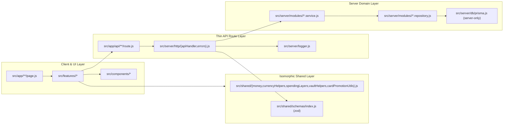

# Vault Tracking — System Architecture & Developer Guide

This document describes the internal architecture, directory layout, database design, and engineering rules of **Vault Tracking**.

---

## 1. High-Level Layered Architecture

The Next.js 15 App Router application lives inside [`application/`](../application) and follows a strict 4-layer separation inside `application/src/`:



### Directory Responsibilities

| Path | Layer | Responsibility |
| :--- | :--- | :--- |
| `src/app/api/**/route.js` | **HTTP Transport** | Thin route wrappers (`<= 50` lines) using `withApiHandler()`. No raw Prisma queries or `console.error` calls. |
| `src/server/http/apiHandler.js` | **HTTP Middleware** | Centralized auth enforcement (`USER`, `ADMIN`, `ALLOW_MUST_CHANGE_PASSWORD`, `false`), `zod` payload validation, `AppError` mapping, `requestId` correlation, and structured logging. |
| `src/server/logger.js` | **Observability** | Zero-dependency structured logger controlled by `LOG_LEVEL` (`debug\|info\|warn\|error`). Emits single-line JSON in production and readable lines in development with automatic secret redaction. |
| `src/server/db/prisma.js` | **Database Client** | `import "server-only"` Prisma Client singleton safe for serverless warm starts and local HMR. |
| `src/server/modules/<domain>/` | **Domain Logic** | Business rules (`*.service.js`) and database queries (`*.repository.js`) organized by domain (`auth`, `admin`, `vaults`, `reconcile`, `transactions`, `ledger`, `cards`, `debts`, `categories`, `parties`, `dashboard`, `analytics`, `media`). |
| `src/shared/` | **Isomorphic Pure** | Client-and-server safe utilities (`money.js`, `currencyHelpers.js`, `spendingLayers.js`, `vaultHelpers.js`, `cardPromotionUtils.js`) and `zod` schemas (`src/shared/schemas/index.js`). Zero database or Node-only imports. |
| `src/features/<domain>/` | **Client Features** | Domain-scoped UI sections extracted from complex modals and pages (`vaults`, `transactions`, `analytics`, `settings`). |
| `src/components/` | **Shared UI** | Reusable Material UI components (`VaultAvatar`, `MoneyValue`, `CurrencyTextField`, navigation shell, drawers). |

---

## 2. Database & Media Architecture (PostgreSQL)

- **Database Engine**: PostgreSQL (`application/prisma/schema.prisma`), compatible with both **Neon Serverless PostgreSQL** (`DATABASE_URL` pooled + `DIRECT_URL` direct) and **self-hosted PostgreSQL 17** in Docker.
- **Exact Cent Precision**: All monetary columns use PostgreSQL `Decimal` (`NUMERIC`) and are processed in JavaScript exclusively via `decimal.js` helpers in `src/shared/money.js` (`toDecimal`, `addMoney`, `subMoney`, `mulMoney`, `divMoney`, `roundMoney`). Raw floating-point math is never used for ledger balances.
- **Atomic Double-Entry Transactions**: Every ledger write, reversal, vault reconciliation, debt settlement, or write-off executes inside `prisma.$transaction(...)` so `transactions`, `transaction_legs`, `vaults.current_balance`, `vault_sub_containers.current_balance`, and `debt_ledger_entries` remain 100% synchronized.
- **Zero-Disk Media Storage (`MediaAsset`)**:
  - Cropped vault profile images are encoded to `image/webp` (quality `0.85`, 512×512) in the browser Canvas before upload.
  - The server stores the binary payload in PostgreSQL `media_assets` (`data Bytes` / `bytea`) scoped to `user_id` and serves it from `GET /api/media/vaults/<id>.webp` with `Cache-Control: private, max-age=31536000, immutable`.

---

## 3. Core Financial Invariants

1. **Strict Consumption Invariant (`consume_amount`)**:
   - Only personal expenses (`nature = EXPENSE` with `party = SELF`, `PAYABLE_BORROW` in `EXPENSE_TALANG` mode, and forgiven debt write-offs) produce `consume_amount < 0`.
   - `INITIAL_FUND`, `TRANSFER`, `RECEIVABLE_LEND`, `RECEIVABLE_COLLECT`, `PAYABLE_REPAY`, and `DEBT_OFFSET` strictly set `consume_amount = 0`.
2. **Retroactive Backdated Absorption**:
   - When a user logs a transaction dated earlier than a vault's latest `VaultCheckpoint`, the ledger marks `isBackdated = true`, links the checkpoint, and absorbs the delta into the checkpoint's unexplained discrepancy or anchor without corrupting the vault's live post-audit balance.
3. **Deterministic In-House Habit Engine**:
   - `src/lib/habitEngine.js` computes real-time card scores (`0–100`) from `CardHabitStat` using time-of-day matching (`35%`), day-of-week matching (`20%`), cadence interval due ratio (`25%`), recency (`10%`), and user pin priority (`10%`) with zero external AI calls.

---

## 4. Verification & Scripts

Run from the repository root or `application/`:

```bash
# Validate Prisma schema & generate client
cd application
npx prisma validate
npx prisma generate

# Run ESLint
npm run lint

# Build production standalone bundle
npm run build

# Run end-to-end HTTP API verification suite (requires running server + PostgreSQL)
npm run verify:api
```
